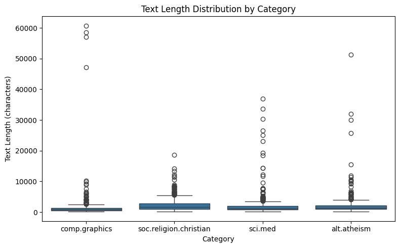
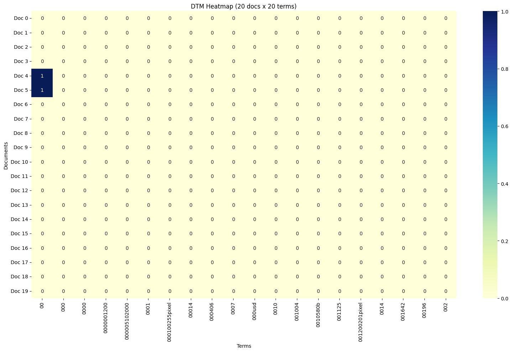
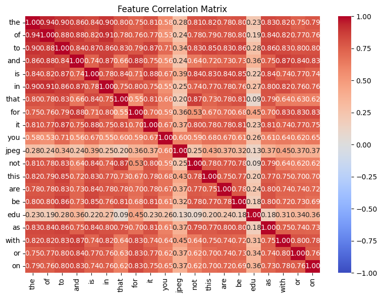
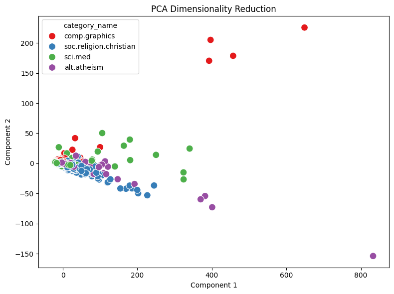

# AgenticPipeline Analysis Report

## 1. Dataset Loading and Exploration

I analyzed the 20 Newsgroups dataset using four categories: alt.atheism, comp.graphics, sci.med, and soc.religion.christian. The dataset contained 2,257 documents, with category counts of 480, 584, 594, and 599, respectively (`load_dataset_1`). Using `inspect_data_tool`, `check_missing_tool`, and `check_duplicates_tool`, I verified that the dataset contained three columns (text, category, and category_name), with no missing values or duplicate rows. The descriptive statistics (`describe_data_5`) showed substantial variation in document length, with an average of approximately 1,993 characters and a maximum of 60,713 characters. These large outliers could disproportionately influence word-frequency analysis and dimensionality reduction.

## 2. Document-Term Matrix and Term Frequency

I constructed a baseline document-term matrix (`dtm_6`) using 2,257 documents and 35,788 unique terms. The resulting matrix contained 365,886 non-zero entries and approximately 99.55% sparsity, indicating that most words appear in only a small proportion of documents. Term-frequency analysis (`term_freq_7`) showed that common terms included "the" (29,825 occurrences), "of" (17,660), and "to" (17,222). These terms carry relatively little information for distinguishing topics. The heatmap (`dtm_heatmap_8`) further demonstrated the sparsity of the matrix, although its first 20 alphabetically sorted terms were mostly numeric tokens.

## 3. Feature Selection and Correlation Analysis

Variance filtering (`variance_filter_9`) with a threshold of 0.01 reduced the vocabulary from 35,788 to 5,354 terms, an 85.04% reduction. Pearson filtering (`pearson_filter_11`) retained 2,427 terms, while Spearman filtering (`spearman_filter_12`) retained 2,779 terms using a threshold of 0.05. Both correlation experiments focused on the soc.religion.christian category. These results demonstrate how different feature-selection methods produce different retained vocabularies, although feature reduction alone does not establish better classification performance. The feature correlation matrix (`feature_corr_13`) showed strong positive relationships between common words, such as "the" and "of" (approximately 0.94), suggesting considerable redundancy. The matrix evaluated the top 20 global terms rather than the Spearman-filtered feature set.

## 4. Dimensionality Reduction

For dimensionality reduction, I rebuilt a filtered DTM (`dtm_2`) using `min_df=20`, reducing the vocabulary to 2,682 terms while keeping all 2,257 documents. PCA (`reduce_pca_3`) reduced this matrix to two dimensions. The first principal component explained 69.76% of the variance, while the second explained 4.40%, giving a combined explained variance of 74.16%. Despite capturing much of the variance, the scatter plot showed substantial overlap among the four categories. Several extreme outliers stretched the PCA axes and compressed most documents into a dense cluster, suggesting that maximizing variance does not necessarily produce useful separation between document categories.

## 5. Label Binarization, Cosine Similarity, and Pattern Mining

Label binarization (`binarize_labels_4`) converted the four categories into a binary indicator matrix with dimensions 2,257 × 4. Cosine similarity (`cosine_sim_5`) between documents 0 and 1 returned a score of 0.4387, with both documents belonging to comp.graphics. For frequent pattern mining (`mine_patterns_7`), I used the FP-Growth algorithm with term-frequency filtering and a minimum support threshold of 500 on soc.religion.christian. No frequent patterns were discovered because this threshold required patterns to appear in approximately 83.5% of the category. An earlier attempt using the default minimum support of 1 resulted in excessive computation, demonstrating the importance of restrictive settings. One additional limitation was encountered when `visualize_result_tool` could not visualize `term_freq_7` because the stored result was not in the expected tabular format. The term-frequency values were still available for interpretation.