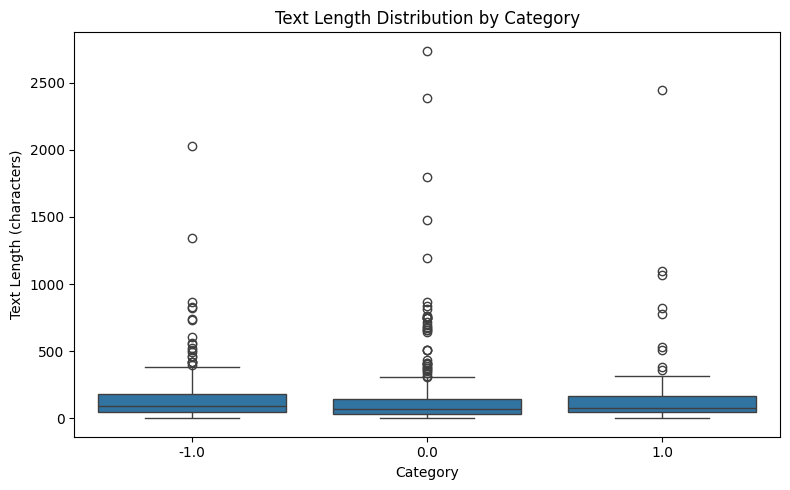
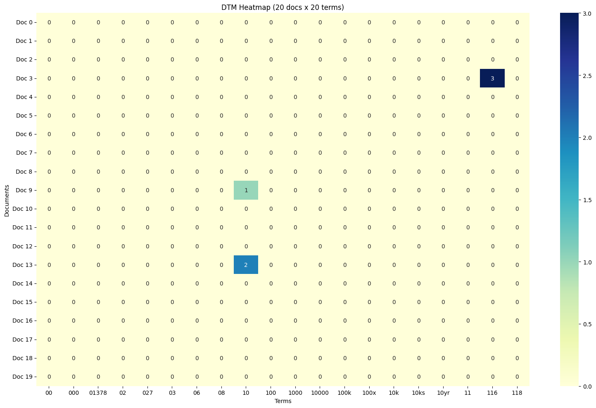
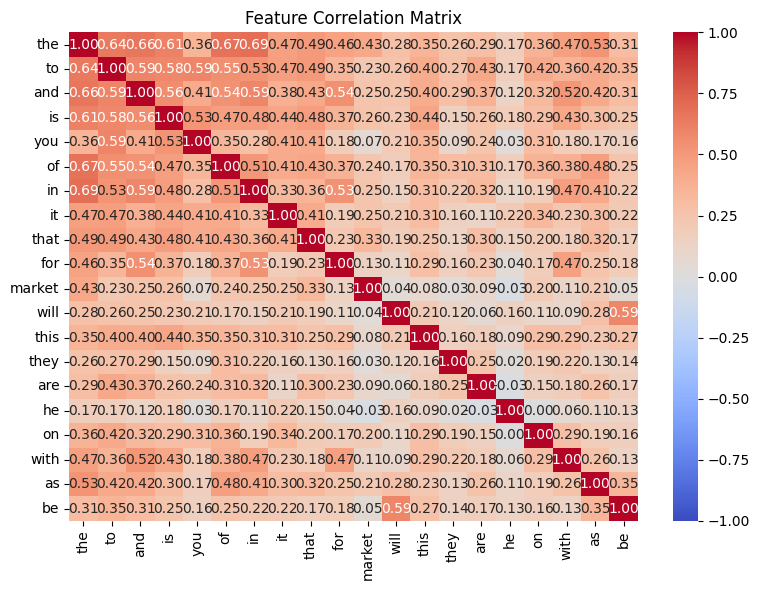
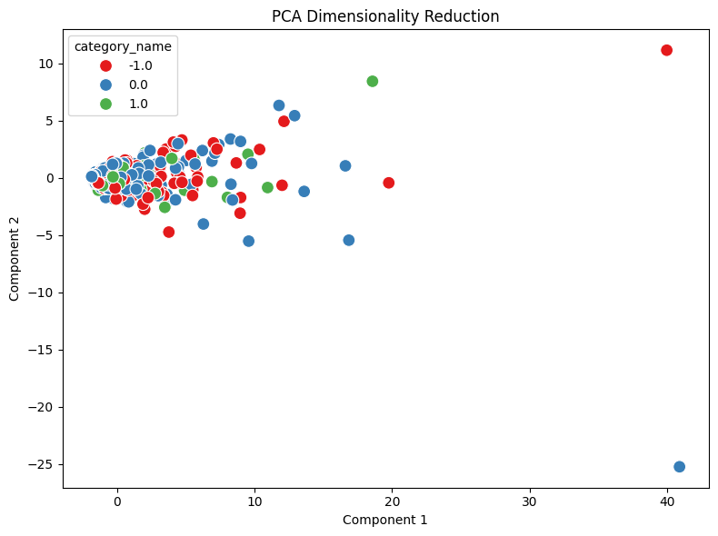

# Homework Report: Reddit Stock Sentiment Analysis

I analyzed the Reddit Stock Sentiment dataset containing 847 comments across three sentiment categories: negative (315), neutral (423), and positive (109). After loading the dataset (`load_dataset_1`), I inspected its structure (`inspect_2`) and checked for missing values (`check_missing_3`) and duplicates (`check_duplicates_4`). No missing values were found, but 23 duplicate rows (2.72%) were identified and retained. Descriptive statistics (`describe_data_5`) showed an average comment length of 147.44 characters and a median of 78 characters, with several long outliers across all sentiment categories.

I built a baseline document-term matrix (`dtm_6`) containing 847 documents and 4,346 terms, with 99.53% sparsity. Term-frequency analysis (`term_freq_7`) showed that common words such as "the", "to", and "and" dominated the vocabulary rather than meaningful sentiment-related terms. The heatmap (`dtm_heatmap_8`) confirmed this sparsity, with only three non-zero entries in a 20 × 20 subset. Variance filtering (`variance_filter_9`) reduced the vocabulary to 506 terms, an 88.36% reduction.

I compared Pearson (`pearson_filter_10`) and Spearman (`spearman_filter_11`) correlation filtering using a threshold of 0.05 and positive sentiment as the target class. Pearson retained 689 terms, while Spearman retained 691, showing similar levels of feature reduction. The feature correlation matrix (`feature_corr_12`) revealed moderate-to-strong positive correlations among common words, including "the" and "in" (0.6943), suggesting redundant information in the text representation. The correlation matrix used the top 20 global terms rather than the Spearman-filtered features.

For frequent pattern mining (`mine_patterns_13`), I used FP-Growth with term-frequency filtering on the positive sentiment category. With a minimum support of 80 out of 109 documents, no frequent patterns were discovered. This restrictive threshold helped the computation finish successfully but may have excluded meaningful patterns. For dimensionality reduction, I rebuilt the DTM (`dtm_14`) using `min_df=5`, reducing the vocabulary to 613 terms. PCA (`reduce_pca_15`) then projected the data into two dimensions, explaining 39.60% of the total variance. The scatter plot showed substantial overlap among the three sentiment categories.

Finally, label binarization (`binarize_labels_16`) converted the sentiment labels into an 847 × 3 binary matrix for one-vs-rest analysis. Cosine similarity (`cosine_sim_17`) between a negative and a positive comment was 0.0971, indicating little vocabulary overlap. Overall, the analysis demonstrated that short Reddit comments produce highly sparse text representations, and although feature selection reduces dimensionality, it does not necessarily separate sentiment categories clearly. Duplicate comments, class imbalance, and restrictive filtering settings remain important limitations.